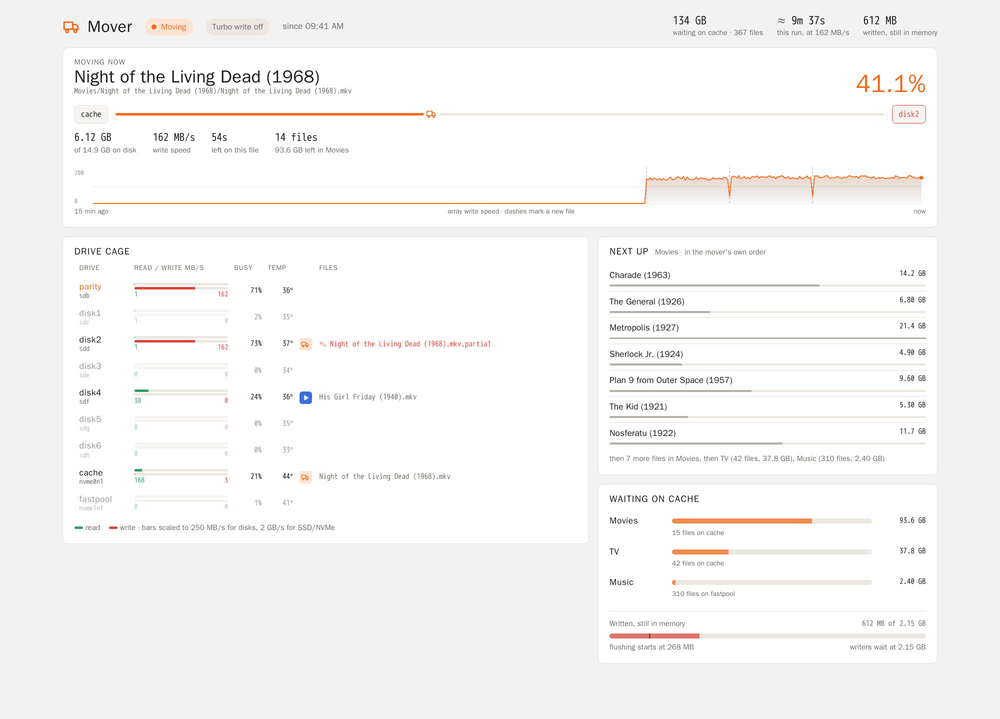

# Mover Dashboard for Unraid



A **Mover** tab that shows what the mover is doing while it runs:

- the file being moved, from which pool to which drive, with progress, speed and time left
- the next files in the mover's own order, and what is left in each share
- what is waiting on each cache pool
- read and write per drive, how busy each drive is, its temperature, and which app has its files open (container icons; the mover shows as a truck)
- data written but still in memory, against the kernel's write-back limits
- array write speed over the last 15 minutes, with a mark at each new file

It only reads: the mover's pid and progress files, the file lists the mover writes for each share, the files the user-share layer (`shfs`) has open, `/proc/diskstats` and `/proc/meminfo`. It does not start, stop or change the mover.

Requires Unraid 7.0 or later. MIT licensed. Turn on **Settings → Mover Settings → Mover progress** for exact totals and ETA.

## Install

Plugins → Install Plugin, then paste:

```
https://raw.githubusercontent.com/RapidMark/unraid-mover-dashboard/main/mover.dashboard.plg
```

## How progress is measured

The mover's copy reserves the full file size up front and writes by offset, so neither the file size nor its position shows how far it has got. Progress is what the destination drive has written since the file started, which is right while the mover is the only writer on that drive, and counts data on disk rather than data still in memory.

## Build

```
./build.sh 2026.11.20
```

Builds `packages/mover.dashboard-<version>.txz` from `src/` and writes its version and md5 into `mover.dashboard.plg`. Attach the package to a GitHub release tagged with the same version.
